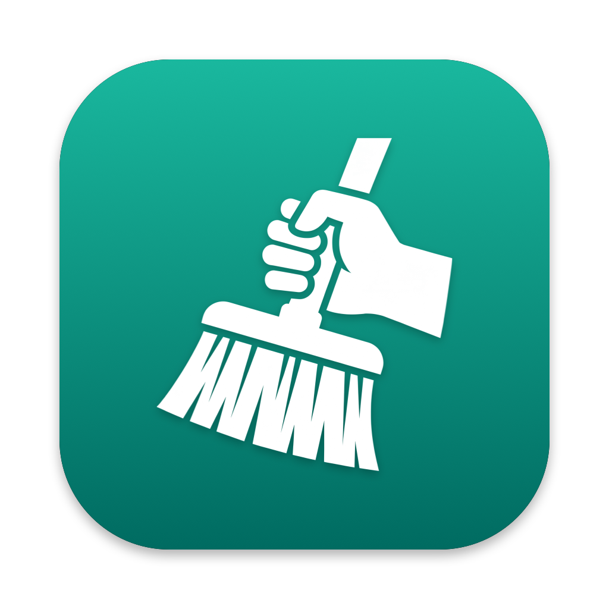
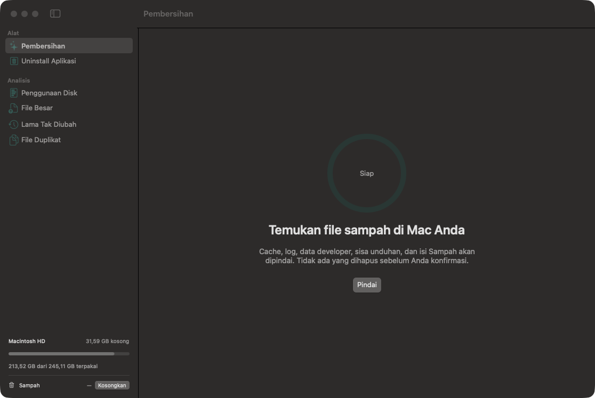

<p align="center"></p>

# CleanBro

Two tools for inspecting and tidying up disk usage on macOS:

- **`cekdisk`**: a Go CLI that scans folder sizes quickly and in parallel, similar to `du`, with a tree view and a list of the largest files.
- **CleanBro**: a native SwiftUI app for cleaning junk files, uninstalling apps, and analyzing your disk.



## cekdisk (CLI)

### Build

Requires Go (see the version in `go.mod`).

```sh
go build -o cekdisk .
```

### Usage

```sh
cekdisk [options] [path]      # default path: ~
```

| Option | Default | Description |
|--------|---------|-------------|
| `-d` | `1` | Tree depth to display |
| `-n` | `20` | Number of top folders per level (`0` = all) |
| `-f` | `15` | Show the N largest files (`0` = off) |
| `-x` | `false` | Don't cross into other filesystems/volumes |
| `-j` | `CPU × 4` | Number of parallel goroutines |

Examples:

```sh
cekdisk ~
cekdisk -d 2 -n 10 ~/Library
sudo cekdisk -d 1 /
```

Sample output:

```
📁 ~/Library  —  total 35.9 GiB, 279216 file, 77335 folder  (5.33s)

  24.8 GiB  ██████████████░░░░░░  69.0%  Application Support/
   3.8 GiB  ██░░░░░░░░░░░░░░░░░░  10.6%  Containers/
   3.7 GiB  ██░░░░░░░░░░░░░░░░░░  10.2%  Developer/
   3.2 GiB  ██░░░░░░░░░░░░░░░░░░   9.1%  Caches/
 154.6 MiB  ░░░░░░░░░░░░░░░░░░░░   0.4%  HTTPStorages/
 285.3 MiB                               … 108 folder lainnya

💾 Volume: 202.6 GiB terpakai dari 228.3 GiB, sisa 25.7 GiB
```

Notes:

- Sizes are the disk blocks actually allocated (like `du`), not the logical file size.
- Hard links are counted only once.
- `/Volumes`, `/System/Volumes`, and `/dev` are skipped to avoid double counting, unless that path itself is being scanned.
- If you see a "permission denied" warning, run with `sudo` or grant **Full Disk Access** to Terminal (System Settings → Privacy & Security).

## CleanBro (macOS app)

Requires macOS 14 (Sonoma) or later and the Swift 6 toolchain (Xcode 16+).

### Features

**Tools**
- **Cleanup**: scans and removes app caches, logs and crash reports, developer data (Xcode DerivedData, DeviceSupport, simulator caches, npm, Gradle, `~/.cache`), incomplete downloads, and the Trash.
- **Uninstall Apps**: removes an app together with its support files.

**Analysis**
- **Disk Usage**: folder size tree.
- **Large Files**: files of 100 MB or more.
- **Stale Files**: files that haven't been modified in a long time.
- **Duplicate Files**: finds duplicates by size, then by SHA-256 hash.

Files can be moved to the Trash or deleted permanently. Folders you don't want scanned can be excluded in Settings (⌘,).

### Build

```sh
cd CleanBro
./build.sh
open build/CleanBro.app
```

`build.sh` builds a universal (Apple Silicon + Intel) release with SwiftPM, assembles the `CleanBro.app` bundle (with `Icon/AppIcon.icns`) in `CleanBro/build/`, signs it ad-hoc, and creates `CleanBro.zip` for sharing.

To use it on another Mac, share `CleanBro.zip` (don't copy the `.app` folder directly). Because the app isn't notarized by Apple, macOS blocks it on first launch: open **System Settings → Privacy & Security** and click **Open Anyway**. Or from Terminal:

```sh
xattr -dr com.apple.quarantine /Applications/CleanBro.app
```

If you get *"The application “CleanBro.app” can't be opened."*, the bundle was most likely damaged in transit (the executable permission was lost, or `._*` files ended up inside it). Re-extract the zip with Archive Utility (double-click it), or repair it from Terminal:

```sh
APP=/Applications/CleanBro.app
find "$APP" -name '._*' -delete
chmod +x "$APP/Contents/MacOS/CleanBro"
xattr -cr "$APP"
codesign --force --deep --sign - "$APP"
```

To regenerate the app icon, run `swift Icon/make-icon.swift` from the `CleanBro/` folder.

For development:

```sh
cd CleanBro
swift run
```

### Permissions

To read the Trash and some folders in `~/Library`, grant CleanBro **Full Disk Access** in System Settings → Privacy & Security → Full Disk Access. The app shows a reminder if this permission hasn't been granted yet.

## CI/CD

GitHub Actions ([`.github/workflows/build.yml`](.github/workflows/build.yml)) builds `CleanBro.app` and a universal `cekdisk` on every push to `main` and on pull requests. Build outputs can be downloaded as artifacts from the **Actions** tab.

To release, push a version tag. The workflow creates a GitHub Release containing `CleanBro.zip`, `cekdisk-macos-universal.tar.gz`, and `SHA256SUMS.txt`, with the app version taken from the tag name:

```sh
git tag v1.0.0
git push origin v1.0.0
```

## Project structure

```
.
├── main.go            # cekdisk source
├── go.mod
├── CleanBro/
│   ├── Package.swift
│   ├── build.sh       # build & bundle the .app
│   ├── Icon/          # AppIcon.icns + make-icon.swift generator
│   └── Sources/CleanBro/
├── docs/screenshots/  # README images
└── template/          # UI design mockup (HTML)
```

## License

Copyright (C) 2026 gilang

This program is free software: you can redistribute it and/or modify it under the terms of the [GNU General Public License version 3](LICENSE) as published by the Free Software Foundation.

This program is distributed in the hope that it will be useful, but WITHOUT ANY WARRANTY. See the [LICENSE](LICENSE) file for details.
